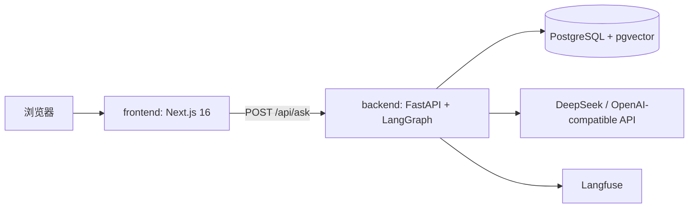

# Portfolio Agent

求职作品集 Agent：访客可浏览我的经历，并向内置 Agent 提问，Agent 基于真实资料回答。

## 架构



## 快速开始

### 0. 环境要求

- Docker Desktop（含 Compose v2）
- Git
- 一个 OpenAI-compatible 的 LLM API key（本文以 DeepSeek 为例）
- 可选：`cloudflared`，用于把本地服务暴露到公网

### 1. 获取代码

```bash
git clone https://github.com/shuai-wk/portfolio-agent.git
cd portfolio-agent
```

### 2. 配置环境变量

```bash
cp .env.example .env
```

至少把 `POSTGRES_PASSWORD` 改掉。模型 key 的完整说明见[接入真实模型](#接入真实模型)。

### 3. 准备本地数据

```bash
cp -r data.example data
```

把你的真实资料写成 Markdown 放进 `data/documents/*.md`。每个文件会按标题切块后入库，建议按主题拆分，例如：

```text
data/documents/
├── 01_profile.md
├── 02_education.md
├── 03_internship_knowledge_graph.md
├── 04_internship_agent.md
├── 05_project_detection.md
├── 06_skills.md
└── 07_patents_awards.md
```

`data/` 已加入 `.gitignore`，你的资料不会进入 GitHub。

### 4. 启动服务

```bash
docker compose up --build -d
docker compose ps
```

三个服务都应为 running，`postgres` 和 `backend` 应为 healthy。首次构建会下载镜像并安装依赖，需要几分钟。

### 5. 导入索引

```bash
docker compose run --rm backend python -m scripts.seed
```

看到 `Seeded N documents ...` 即表示索引已写入 PostgreSQL。

### 6. 本地验证

```bash
curl http://localhost:8000/health
```

期望返回：

```json
{"status":"ok"}
```

浏览器打开 http://localhost:3000，输入问题即可。

### 停止

```bash
docker compose down
```

## 公网访问（Cloudflare Tunnel）

目标：把本机的前端 `localhost:3000` 暴露成一个公网 HTTPS 地址，数据仍然只留在你本机。

### 临时 Quick Tunnel（无需账号）

Windows 下载并启动：

```powershell
Invoke-WebRequest -Uri "https://github.com/cloudflare/cloudflared/releases/latest/download/cloudflared-windows-amd64.exe" -OutFile cloudflared.exe
.\cloudflared.exe --version
.\cloudflared.exe tunnel --url http://localhost:3000 --no-autoupdate --protocol http2
```

macOS / Linux：

```bash
cloudflared tunnel --url http://localhost:3000 --no-autoupdate --protocol http2
```

终端会输出类似内容：

```text
Your quick Tunnel has been created! Visit it at:
https://<random>.trycloudflare.com
```

把这个地址发给别人即可。首次可能需要等几秒到几十秒才能访问。

说明：

- `--protocol http2` 用于 QUIC/UDP 被网络拦截的环境。如果日志里 `UDP Connectivity` 为 FAIL，就保留这个参数。
- Quick Tunnel 不需要 Cloudflare 账号，但地址是临时的，重启后会变化，也没有 uptime 保证。
- 电脑休眠、Docker 停止或 `cloudflared` 退出，链接就会失效。
- 停止：在运行 `cloudflared` 的终端按 `Ctrl+C`，或在 Windows 执行 `Stop-Process -Name cloudflared`。

### 稳定 Named Tunnel（可选，需要域名）

如果需要固定域名，使用 Cloudflare 账号和已接入 Cloudflare 的域名：

```bash
cloudflared tunnel login
cloudflared tunnel create portfolio-agent
cloudflared tunnel route dns portfolio-agent agent.example.com
```

创建 `%USERPROFILE%\.cloudflared\config.yml`：

```yaml
tunnel: portfolio-agent
credentials-file: C:\Users\<you>\.cloudflared\<tunnel-id>.json
ingress:
  - hostname: agent.example.com
    service: http://localhost:3000
  - service: http_status:404
```

启动：

```bash
cloudflared tunnel run portfolio-agent
```

长期公开时建议再加 Cloudflare Access、限流或访问口令，避免陌生人消耗你的 LLM 额度。

## 数据与隐私

仓库只包含代码和合成示例，不包含个人资料。个人语料放在本地的 `data/documents/*.md`，`data/` 已加入 `.gitignore`。

- 数据存在你本机的 PostgreSQL 和 `data/` 目录。
- Cloudflare 只转发 HTTP 流量，不保存你的语料。
- `.env` 里的 API key 不会被提交。
- `eval/corpus/` 是合成评测样例，不含个人数据。

公开部署前请确认：你愿意让访客通过提问看到哪些信息（例如电话、邮箱、政治面貌等）。

## 接入真实模型

后端通过 OpenAI-compatible 接口调用 LLM 和 embedding；未配置 key 时自动回退到 mock，方便本地跑通。在 `.env` 中填入：

```bash
LLM_BASE_URL=https://api.openai.com/v1
LLM_API_KEY=sk-...
LLM_MODEL=gpt-4o-mini
LLM_MAX_TOKENS=1024
EMBEDDING_BASE_URL=https://api.openai.com/v1
EMBEDDING_API_KEY=sk-...
EMBEDDING_MODEL=text-embedding-3-small
```

也可以换成 DashScope、智谱、DeepSeek 或本地 Ollama 等兼容接口，只要 `*_BASE_URL` 和模型名对应即可。

DeepSeek 目前只有对话模型、没有 embedding 接口。只填 `LLM_*` 时，后端会自动使用本地词法 embedding（256 维），不需要第二个 key；如果想要更好的语义检索，再补 `EMBEDDING_*`。DeepSeek 示例：

```bash
LLM_BASE_URL=https://api.deepseek.com
LLM_API_KEY=sk-...
LLM_MODEL=deepseek-flash
LLM_MAX_TOKENS=1024
EMBEDDING_BASE_URL=
EMBEDDING_API_KEY=
EMBEDDING_MODEL=
```

更换 embedding 模型后需要重新导入索引，让新的向量维度生效：

```bash
docker compose run --rm backend python -m scripts.seed
```

密钥只放在 `.env` 或服务器环境变量里，`.env` 已被 gitignore。不要把 key 发到公开聊天或提交到仓库。

## 常见问题

### 容器显示 Exited (137)

Docker Desktop 重启或资源不足时可能发生。重新拉起：

```bash
docker compose up -d
docker compose ps
```

### Cloudflare 隧道报 QUIC / UDP 失败

使用 HTTP/2：

```bash
cloudflared tunnel --url http://localhost:3000 --no-autoupdate --protocol http2
```

### 问答没有来源或说“不知道”

1. 确认 `data/documents/` 里有 Markdown 文件。
2. 重新导入：

```bash
docker compose run --rm backend python -m scripts.seed
```

3. 确认 `docker compose ps` 中 backend 是 healthy。

### 端口被占用

在 `.env` 中修改 `BACKEND_PORT` 或 `FRONTEND_PORT`，再重新启动。

## 技术选型说明

### 为什么用 pgvector 而不是专用向量数据库

这个 Agent 的语料是个人作品集，规模通常在几千个片段以内。pgvector 直接挂在现有 PostgreSQL 里，向量、正文和元数据放在同一张表，享受事务、备份和熟悉的运维能力，不用额外维护一个独立服务。专用向量数据库更适合超大语料、独立扩展或极致延迟的场景，在这里属于不必要的复杂度。

### 为什么用 FastAPI 而不是 Node 后端

LangGraph、Langfuse SDK 以及 RAG 生态都以 Python 为一等公民，模型编排、向量检索和可观测性都在同一语言里，后端与评测也共享依赖。FastAPI 的异步模型正好匹配检索加生成这种 I/O 密集链路。用 Node 会额外维护一套 AI 工具链，跨语言切换成本更高。

## 目录

- `backend/`：Python 3.12 + FastAPI + LangGraph + PostgreSQL/pgvector。
- `frontend/`：Next.js 16 + TypeScript + Tailwind。
- `eval/`：离线评测，含 Golden Set、检索指标和忠实度检查。
- `data.example/`：本地数据目录模板（不含真实资料）。

## 评估结果

评测集为 `eval/golden_set.jsonl`（30 条），指标由 `python eval/run_eval.py` 真实计算。

### 切块策略对比

| 指标 | fixed | semantic |
| --- | --- | --- |
| Hit@1 | 0.5333 | 0.4333 |
| Hit@3 | 0.8667 | 0.8000 |
| Recall@5 | 0.9333 | 0.8667 |
| MRR | 0.6983 | 0.6111 |

当前语料与词法 embedding 下，`fixed`（约 512 token）优于 `semantic`。详见 `eval/report_chunking.md`。

### 忠实度

随机抽取 10 条，平均忠实度 0.2883，其中 9 条 `not_faithful`、1 条 `partial`。当前 LLM 为 mock，尚未真正引用上下文。详见 `eval/report_faithfulness.md`。

## 工程化

- CI：`.github/workflows/ci.yml`，backend 跑 ruff + pytest，frontend 跑 lint + typecheck。
- 后端质量门禁：`uv run --extra dev ruff check . && uv run --extra dev pytest -q`。
- 前端质量门禁：`pnpm lint && pnpm typecheck`。
