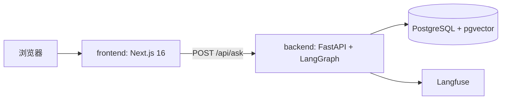

# Portfolio Agent

求职作品集 Agent：访客可浏览我的经历，并向内置 Agent 提问，Agent 基于真实资料回答。

## 架构



## 本地启动

```bash
cp .env.example .env
docker compose up --build
```

启动后：

- 前端：http://localhost:3000
- 后端：http://localhost:8000
- 健康检查：`curl http://localhost:8000/health`

停止：`docker compose down`

## 数据与隐私

仓库只包含代码和合成示例，不包含个人资料。个人语料放在本地的 `data/documents/*.md`，`data/` 已加入 `.gitignore`。

首次准备个人数据：

```bash
cp -r data.example data
# 编辑 data/documents/*.md，填入你的真实资料
docker compose run --rm backend python -m scripts.seed
```

部署时把 `data/` 挂载到服务器的 `/data`（compose 已设置 `DATA_DIR=/data`）。访客访问的是你部署的实例，数据始终在你这侧，不会进入 GitHub。`eval/corpus/` 是合成评测样例，不含个人数据。

## 接入真实模型

后端通过 OpenAI-compatible 接口调用 LLM 和 embedding；未配置 key 时自动回退到 mock，方便本地跑通。在 `.env` 中填入：

```bash
LLM_BASE_URL=https://api.openai.com/v1
LLM_API_KEY=sk-...
LLM_MODEL=gpt-4o-mini
EMBEDDING_BASE_URL=https://api.openai.com/v1
EMBEDDING_API_KEY=sk-...
EMBEDDING_MODEL=text-embedding-3-small
```

也可以换成 DashScope、智谱、DeepSeek 或本地 Ollama 等兼容接口，只要 `*_BASE_URL` 和模型名对应即可。改完 embedding 后重建索引，让新的向量维度生效：

```bash
docker compose run --rm backend python -m scripts.seed
```

DeepSeek 目前只有对话模型、没有 embedding 接口。只填 `LLM_*` 时，后端会自动使用本地词法 embedding（256 维），不需要第二个 key；如果想要更好的语义检索，再补 `EMBEDDING_*`。DeepSeek 示例：

```bash
LLM_BASE_URL=https://api.deepseek.com
LLM_API_KEY=sk-...
LLM_MODEL=deepseek-flash
LLM_MAX_TOKENS=1024
EMBEDDING_BASE_URL=
EMBEDDING_API_KEY=
EMBEDDING_MODEL=
```

密钥只放在 `.env` 或服务器环境变量里，`.env` 已被 gitignore。

## 技术选型说明

### 为什么用 pgvector 而不是专用向量数据库

这个 Agent 的语料是个人作品集，规模通常在几千个片段以内。pgvector 直接挂在现有 PostgreSQL 里，向量、正文和元数据放在同一张表，享受事务、备份和熟悉的运维能力，不用额外维护一个独立服务。专用向量数据库更适合超大语料、独立扩展或极致延迟的场景，在这里属于不必要的复杂度。

### 为什么用 FastAPI 而不是 Node 后端

LangGraph、Langfuse SDK 以及 RAG 生态都以 Python 为一等公民，模型编排、向量检索和可观测性都在同一语言里，后端与评测也共享依赖。FastAPI 的异步模型正好匹配检索加生成这种 I/O 密集链路。用 Node 会额外维护一套 AI 工具链，跨语言切换成本更高。

## 目录

- `backend/`：Python 3.12 + FastAPI + LangGraph + PostgreSQL/pgvector。
- `frontend/`：Next.js 16 + TypeScript + Tailwind。
- `eval/`：离线评测，含 Golden Set、检索指标和忠实度检查。

## 评估结果

评测集为 `eval/golden_set.jsonl`（30 条），指标由 `python eval/run_eval.py` 真实计算。

### 切块策略对比

| 指标 | fixed | semantic |
| --- | --- | --- |
| Hit@1 | 0.5333 | 0.4333 |
| Hit@3 | 0.8667 | 0.8000 |
| Recall@5 | 0.9333 | 0.8667 |
| MRR | 0.6983 | 0.6111 |

当前语料与词法 embedding 下，`fixed`（约 512 token）优于 `semantic`。详见 `eval/report_chunking.md`。

### 忠实度

随机抽取 10 条，平均忠实度 0.2883，其中 9 条 `not_faithful`、1 条 `partial`。当前 LLM 为 mock，尚未真正引用上下文。详见 `eval/report_faithfulness.md`。

## 工程化

- CI：`.github/workflows/ci.yml`，backend 跑 ruff + pytest，frontend 跑 lint + typecheck。
- 后端质量门禁：`uv run --extra dev ruff check . && uv run --extra dev pytest -q`。
- 前端质量门禁：`pnpm lint && pnpm typecheck`。
